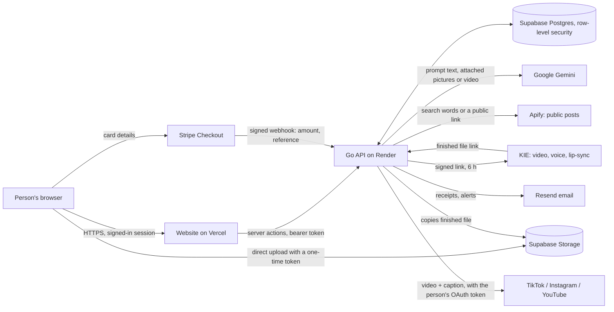

# Data protection: what we hold, where it moves, how long we keep it

Updated 24 Nov 2026. The public wording is in `client/src/lib/legal/privacy.ts`.
This document is the internal version that sits behind it. When the code changes how data is stored or shared, update both.

## 1. What we hold

| Data | Where | Who can read it |
|---|---|---|
| Account: email, name, business name, industry, phone | Supabase Auth + `profiles` | The person; admins |
| Password | Supabase Auth only (hashed) | Nobody, including us |
| Uploads: pictures, videos, voice recordings | Supabase Storage `media` bucket, rows in `media` | The person (row-level security); short-lived signed links |
| Avatar recordings | Storage `avatar-footage` | The person; providers through a signed link while a job runs |
| Library assets and groups | `library_assets`, `library_groups`, `asset_groups` | The person |
| Prompts, scripts, storyboards, chats, memory facts | `jobs.input`, `editor_projects`, `messages`, `user_memories` | The person |
| Finished videos | Storage `media` (copied in from the provider) | The person |
| Connected social accounts | `social_connections`, tokens encrypted with `APP_ENCRYPTION_KEY` | The server only |
| Post performance: views, likes, comments, shares of posts we published | `post_metrics` (YouTube only; TikTok and Instagram expose no public counters) | The person; used to suggest posting times |
| Usage and spend logs | `usage_events`, `ai_usage`, `provider_spend` | Admins |
| Money: payments, invoices, credits | `payments`, `invoices`, `credit_ledger`, `subscriptions` | The person (their own); admins |
| Card numbers | Never held. Stripe's own page takes them | Stripe |

## 2. How data moves

What each outside service receives:

- **Gemini:** the person's words, plus any attached pictures or video when a feature needs to look at them (prompt rewrite, transcription, video analysis).
  - The form autofill sends only the labels and group names of saved assets, never the files.
  - Every call is logged with token counts only, never the text (`ai_usage`).
- **KIE:** a signed link to each file a job needs. The link expires after 6 hours (`media.providerLinkTTL`). Callbacks are refused in production unless they are signed.
- **Apify:** search words or a public post link. No personal data.
- **Resend:** the person's email address and the message.
- **Social platforms:** only what the person chooses to post, at the time they approved, using the token they granted. For YouTube we also read the public counters of posts we published.

On the person's own device the browser keeps conveniences only: an unfinished video form, scripts written for each length (30 minutes), recent searches, the theme and which tips were seen. Nothing there is sent to us beyond what the app already sends.

The end-to-end test stack (`e2e/stack.sh`) never reaches any of these services: kie.ai, Apify and Gemini are a local fake (`server/cmd/fakeproviders`), social posting uses the sandbox, and production refuses to start with `E2E_FAKE_PROVIDERS` set.

## 3. How long we keep it

| Data | Kept | How it is enforced |
|---|---|---|
| Content: uploads, assets, groups, videos, chats, projects | While the account is open; the person can delete any item | Delete buttons; `purge` on account deletion |
| Everything above, after account deletion | Erased, usually within 10 minutes | `purge.Purger.Run` every 10 min. `TestEveryTableWithAUserIsErasedOrDeliberatelyKept` fails if a new table with a `user_id` is not listed |
| Usage and spend logs (`ai_usage`, `usage_events`, `provider_spend`) | 13 months | `purge.LogRetention`, pruned daily by `PurgeStore.PruneLogs` |
| Payments, invoices, credit ledger, subscriptions, admin audit log | As long as accounting law requires | Listed in `KeptTables`. The profile is anonymised so they no longer name the person |
| Signed file links | 30 min for viewing, 6 h for providers | `media.viewTTL`, `media.providerLinkTTL` |
| Provider copies (KIE, Gemini) | Under each provider's own terms | Outside our control. See open item 4 |

## 4. Requests from a person about their data

Requests come to hello@beyondsocial.app and are answered **within 30 days**, which matches Singapore's PDPA.

1. **Check who is asking.** The request must come from the email on the account. If it doesn't, ask them to sign in and write from that address.
2. **Copy of their data** (access request): there is no self-serve export yet (open item 1). An admin gathers:
   - the profile
   - library assets and groups
   - jobs with their prompts
   - finished videos
   - chats and memory facts
   - payments and invoices

   Send it as a zip and record the request in the admin audit log.
3. **Correction:** name and password can be changed in Settings. Anything else an admin edits.
4. **Erasure:** the person deletes their account in Settings, or an admin does it for them. The purge runs within 10 minutes. Financial records stay, anonymised.
5. **Objection or withdrawal of consent for a face or voice:** delete that asset. Videos already made from it stay in the person's library until they delete them.

## 5. Open items

1. **Self-serve export.** Add "Download my data" in Settings, so access requests don't need an admin.
2. **Database backups.** Still missing (see `docs/PROGRESS.md`). A backup also needs a deletion rule: erased accounts must not come back from a restore.
3. **Discovery results.** Scraped public posts in `discoveries` / `discovery_videos` have no age limit. Consider 90 days.
4. **Provider retention.** Confirm in writing how long KIE and Apify keep inputs and outputs, and turn off model training on our data where they offer it.
5. **KIE webhook secret.** Set it under Admin → Providers. Until then, production refuses unsigned callbacks and jobs finish by polling.
